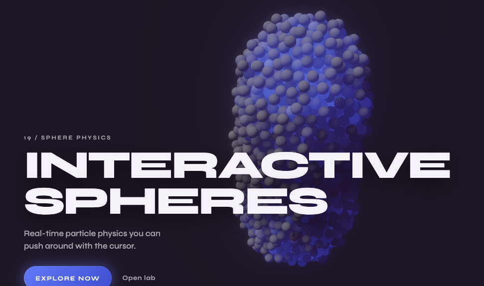

# Sphere Particles Physics

Lesson 19 from the [WebGPU & TSL](https://threejs-journey.com/) course by [Bruno Simon](https://bruno-simon.com/) — interactive sphere particle physics with Three.js TSL compute shaders.

**Live demo:** [askomarov.github.io/19-sphere-particles-physics](https://askomarov.github.io/19-sphere-particles-physics/)



## Setup

Download [Node.js](https://nodejs.org/en/download/).
Run the following commands:

```bash
# Install dependencies (only the first time)
pnpm install

# Run the local server
pnpm dev

# Build for production in the dist/ directory
pnpm build
```

## Course

This project is based on [Three.js Journey](https://threejs-journey.com/) by Bruno Simon.
